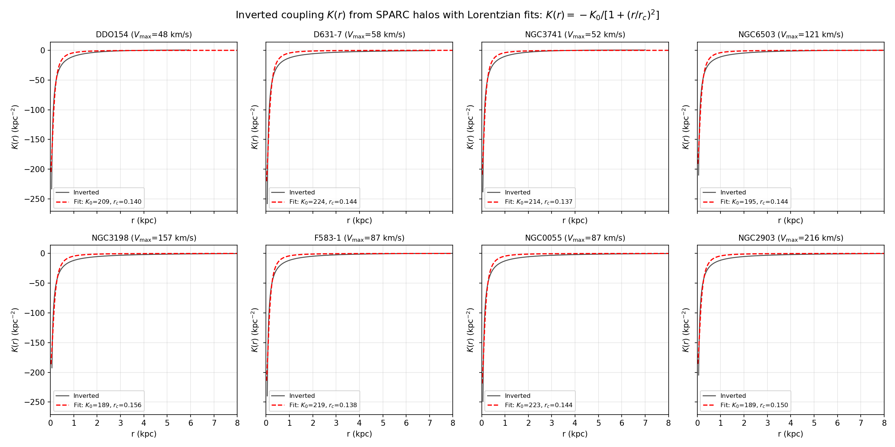
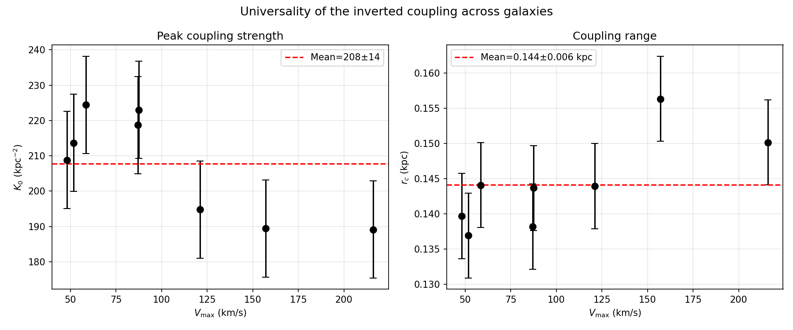

# Dark Matter & Dark Energy: Inverting the Coupling from SPARC

Inverting a universal virtual–real coupling $K(r)$ from SPARC galaxy rotation curves.

## Result

Across 8 SPARC galaxies ($V_{\max}=48$–$216$ km/s), the inverted coupling is universal:

$$K(r) = -\frac{K_0}{1+(r/r_c)^2}$$

- $K_0 = 208 \pm 14\ \mathrm{kpc^{-2}}$ (6.6% scatter)
- $r_c = 0.144 \pm 0.006\ \mathrm{kpc}$ (4.2% scatter)
- Lorentzian fit $R^2 > 0.94$ for every galaxy

Interpretation: each dark matter halo is anchored by a virtual vortex — $r_c$ is the
virtual healing length, $K_0$ the topological charge. Dark matter (localized vortices)
and dark energy (homogeneous background) are two scales of one immersive projection.




## Usage

```bash
pip install -r requirements.txt
```

Sample validation (8 characteristic galaxies, ~1–2 min):

```bash
python src/sample_validation.py --data data --out figs
```

Full validation (all 175 SPARC galaxies, ~15–30 min):

```bash
python src/full_validation.py --data data --out results
```

## Layout

- `src/invert_K.py` — inversion core (static field equations → $K(r)$)
- `src/sample_validation.py` — 8-galaxy sample validation
- `src/full_validation.py` — full-sample universality stress test
- `data/` — SPARC `*_rotmod.dat` (175 galaxies)
- `figs/` — result figures

## Data

SPARC: Lelli, McGaugh & Schombert 2016, AJ 152, 157. Data via Zenodo 16284118.

## License

MIT
